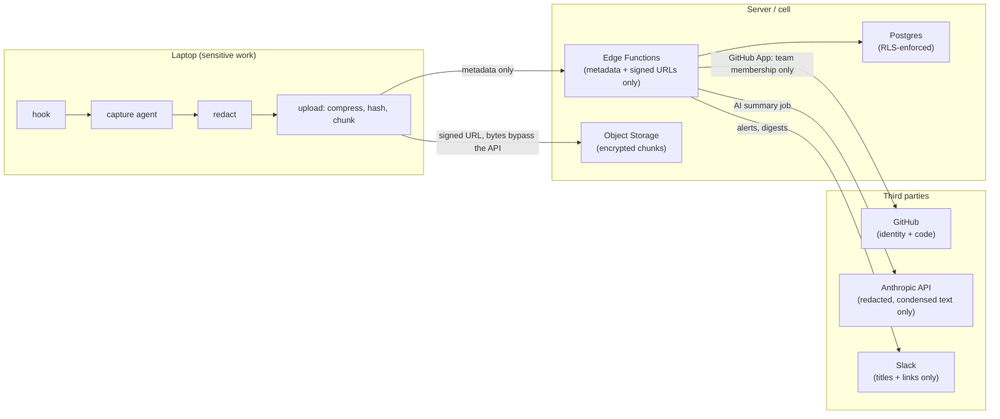
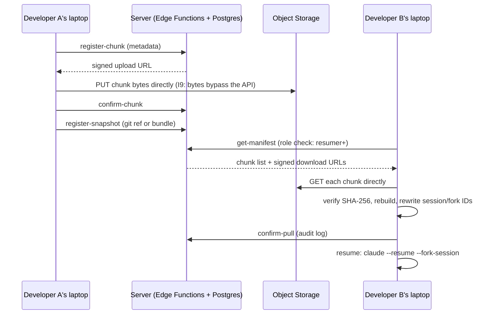
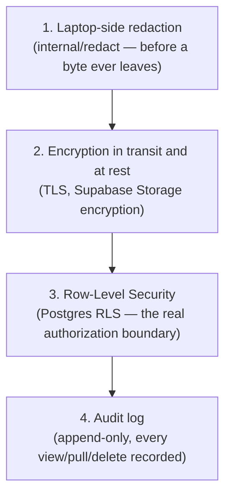

# Architecture

This is the public-facing companion to `.claude/rules/architecture.md` (the binding engineering reference this repo's own contributors follow) and the System Design Document — written for a reader who wants the shape of the system before diving into either. The diagrams below are new for this page; no earlier diagram asset existed to reuse, so these are drawn directly from the SDD's and `architecture.md`'s own text.

## Three trust zones

Carryon's security story rests on keeping three zones distinct — a laptop binary calling the Anthropic API directly, or a web app reading a laptop's local queue file, would blur a line the whole design depends on.

**Laptop** does the expensive and sensitive work — redaction, compression, hashing (`internal/redact`, `internal/upload`, `internal/snapshot`). Nothing here blocks on the network except the agent's own background retries (I1: the developer is never blocked). **Server/cell** is Postgres, Storage, Edge Functions, and scheduled jobs — stateless, horizontally scalable, never a single point of global state. **Third parties** each get only what they strictly need: GitHub sees identity and code, the Anthropic API sees redacted/condensed text, Slack sees titles and links.

## The pull/resume path

The product's own core promise — resuming a teammate's live session, code and conversation both — crosses both trust zones twice.

Every chunk is content-addressed (a per-chunk SHA-256) and the whole sequence is append-only and idempotent — a retried upload or a retried pull is always safe (I2, I3). RLS on `sessions`/`session_chunks` is what actually decides whether `get-manifest` hands Developer B anything at all; a `viewer` role gets zero chunks back, not an error that leaks whether the session exists.

## The four security layers

Per the System Design Document's own "Security architecture" section, in the order they're meant to hold:

A secret that leaves the laptop unredacted is not fixed by any amount of RLS downstream — redaction is layer one, not a backstop. See `.claude/rules/redaction.md` and `docs/co-507-threat-model.md` for how each layer is actually tested, not just asserted.

## Where to read more

- `.claude/rules/architecture.md` — the five architectural principles in full, with the anti-patterns each one rules out.
- `.claude/rules/folder-structure.md` — the full repo tree.
- `docs/co-507-threat-model.md` — the STRIDE threat model, with real tool-run results.
- `Devminified Carryon — System Design Document (SDD).md` — the original design doc these diagrams are drawn from (invariants, scaling tiers, the full security architecture section).
